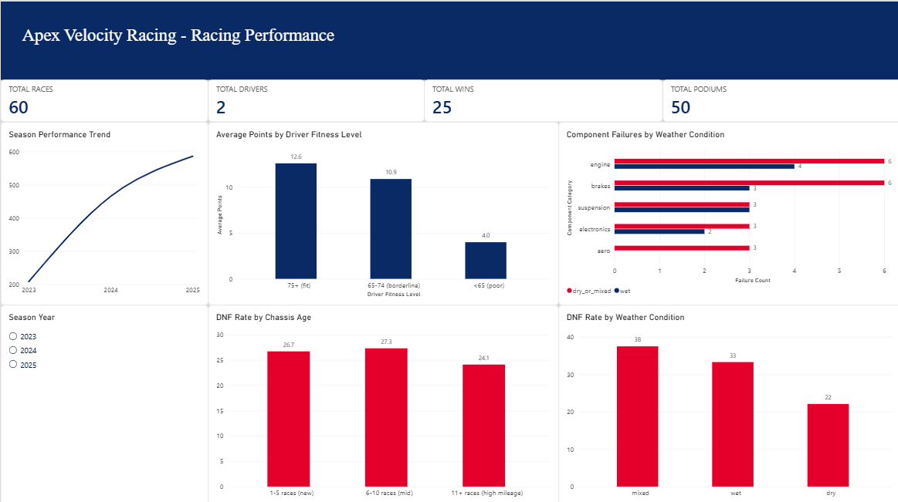
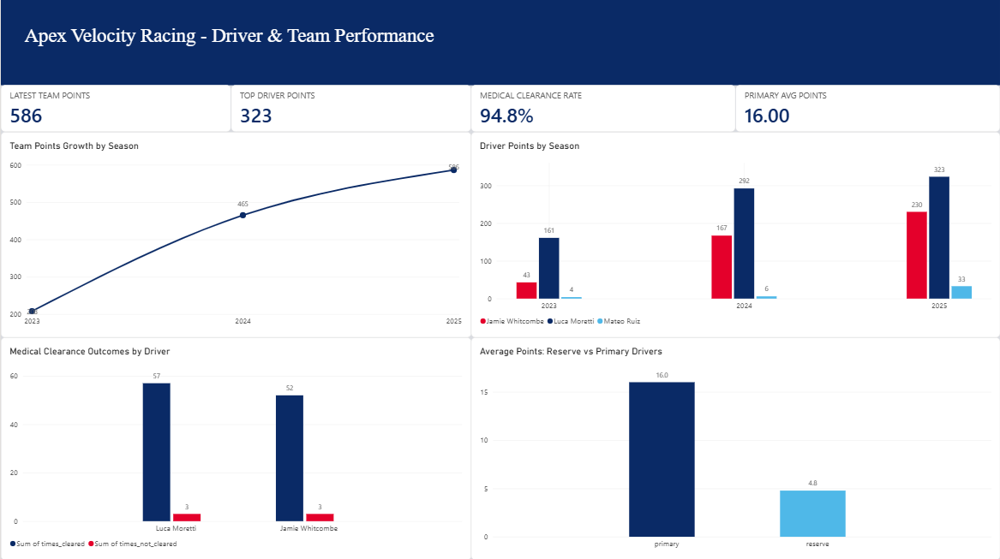
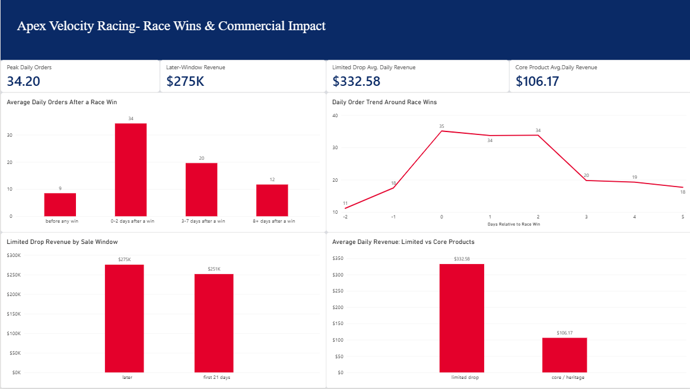
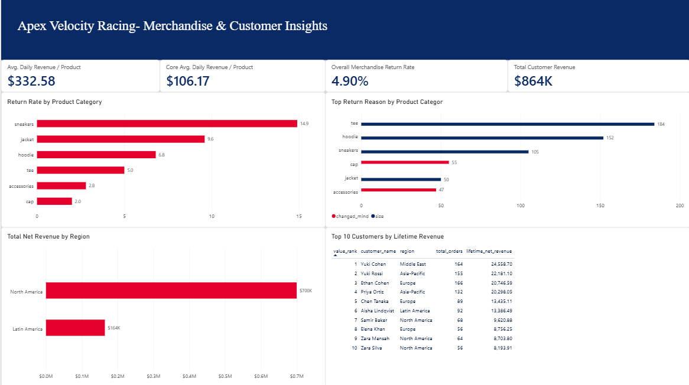

# Apex Velocity Racing
### SQL & Power BI Analytics Project

End-to-end motorsport and business intelligence project exploring racing performance, vehicle reliability, merchandise sales, and customer behavior.

---

## Why I Built This

I wanted a portfolio project that combined three things I'm genuinely interested in: **cars, healthcare, and fashion**. Apex Velocity Racing is a fictional motorsport team that owns cars and drivers, runs a driver and crew health program, and sells its own merch line, three business areas in one database instead of a single flat sales table.

All data is synthetic, generated with a Python script and a fixed random seed, with real patterns (like fitness affecting lap pace, or merch sales spiking after a win) built in on purpose so the SQL analysis had something real to find.

## Tools & Technologies

| Tool | Used For |
|---|---|
| **PostgreSQL / pgAdmin** | Database design and SQL execution |
| **SQL** | CTEs, window functions, joins, aggregate queries |
| **Microsoft Power BI** | Dashboard design, DAX measures, KPI cards, slicers |
| **Python** | Synthetic data generation |
| **GitHub** | Project documentation and version control |

## Business Questions & Findings

| # | Question | Finding |
|---|---|---|
| 1 | Does driver fitness affect lap pace? | Drivers scoring **75+** on fitness checks ran at race average pace and finished about **1 position better** than the 65-74 band |
| 2 | Which components fail most, and what do they cost? | Engines caused the costliest failures, **$265K avg**, and every category's failure rate roughly **doubled** in wet conditions |
| 3 | Does weather or chassis age predict a DNF? | Weather had a clear effect: **22%** DNF rate in dry vs **33-38%** in wet/mixed. Chassis age showed no meaningful trend |
| 4 | Is the team improving season over season? | Points rose **124%** from 2023 to 2024 and kept climbing into 2025 |
| 5 | How often does a failed medical check bench a driver? | Every failed clearance led to a swap; the reserve driver scored about **30%** of the points the primaries did |
| 6 | Do merch sales spike after a win? | Orders peaked at **34/day** in the 2 days after a win, nearly **3x** the pre-win baseline of 11/day |
| 7 | How fast do limited drops sell vs core lines? | Limited drops earned **$332.58/day** per product vs **$106.17/day** for core lines in their first 3 weeks |
| 8 | Which categories get returned most, and why? | Sneakers returned most at **14.9%**, mostly for sizing. Accessories and caps returned least, mostly for "changed mind" |
| 9 | Which regions and customers generate the most value? | North America drove the most total revenue at **$700K**; top 10 customers identified for targeted outreach |

## How I Worked Through It

1. **Explored the data model.** Mapped out how racing, health, and merch data would need to connect through a shared race calendar before writing a single query.
2. **Wrote the SQL.** Nine queries in PostgreSQL, using CTEs, window functions, and joins to answer the questions above, each one tested against the live database before I trusted the numbers.
3. **Exported the results.** Query outputs saved as CSVs to keep a record of what the database actually returned.
4. **Built the dashboard.** Four Power BI pages (Racing Performance, Driver & Team Performance, Race Wins & Commercial Impact, Merchandise & Customer Insights), with a consistent color system where red flags risk and navy/blue flags performance.
5. **Interpreted the results.** Framed every finding around a real business decision, not just a number on a chart.

## Power BI Dashboard

The four-page Power BI report translates SQL analysis into visual insights across racing performance, reliability, commercial outcomes, and customer behavior.

### Page 1 — Racing Performance

### Page 2 — Driver & Team Performance

### Page 3 — Race Wins & Commercial Performance

### Page 4 — Merchandise & Customer Analytics

**[Explore the Power BI Dashboard Files →](dashboard/)**

## Project Files

| Folder | Contents |
|---|---|
| [`sql-queries/`](sql-queries/) | All 9 analysis queries |
| [`data/`](data/) | Exported SQL query results (CSV) |
| [`dashboard/`](dashboard/) | Power BI report and dashboard screenshots |

## Skills Demonstrated

`SQL` `Relational Data Modeling` `KPI Development` `Power BI` `DAX` `Data Visualization` `Analytical Problem Solving` `Business Storytelling`

---

**Built by Lazourde Alshafie**
Business Intelligence Technology student, University of North Florida
